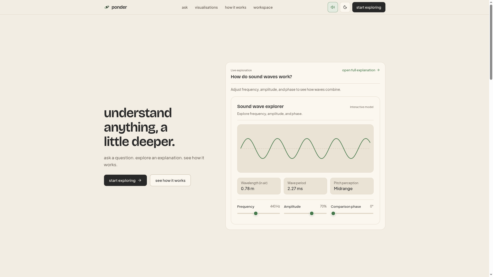

# ponder



interactive concept learning application. ask a question and ponder pairs a clear explanation with an interactive model.

## features

- streaming explanations generated by gemini
- serper.dev web search for grounded answers and citations
- sourced images via wikipedia and serper image search
- interactive visualisations: graphs, simulations, step explorers, timelines, comparisons, diagrams, calculators
- conversation history, saved explorations, private notes
- shareable read-only exploration snapshots
- google sign-in and firestore persistence
- mandatory gemini and serper api key onboarding
- pdf export and text-to-speech listening

## stack

- react 19, typescript, tailwind css 4, vite
- express server with server-sent events
- google gemini api
- serper.dev api
- firebase authentication and cloud firestore

## requirements

- node.js 20 or newer
- npm
- a gemini api key
- a serper.dev api key
- a firebase project (optional, for auth and persistence)

## installation

```bash
npm install
cp .env.example .env
# edit .env and set GEMINI_API_KEY and SERPER_API_KEY
```

## local development

```bash
npm run dev
```

the application runs at http://localhost:3000.

## environment configuration

see `.env.example`. `GEMINI_API_KEY` is required for explanations. `SERPER_API_KEY` is required for web search. firebase client configuration lives in `firebase-config.json`.

## testing

```bash
npm run test
npm run typecheck
```

## production build

```bash
npm run build
npm run start
```

## deployment

build the frontend with `npm run build`, then run `npm run start` with `NODE_ENV=production`. the express server serves the built assets and api routes.

firebase rules are in `firestore.rules`.
